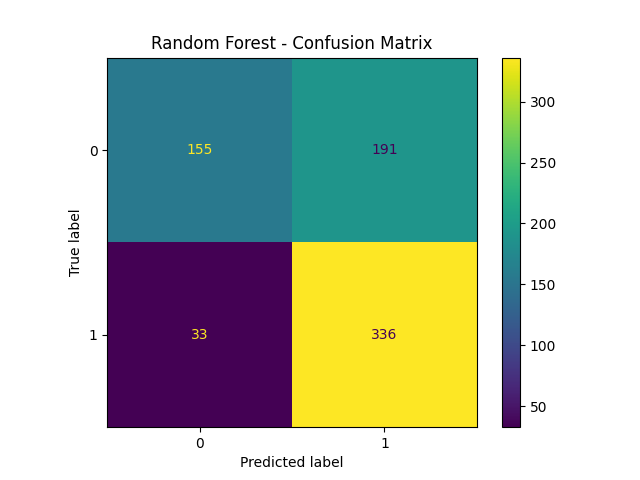
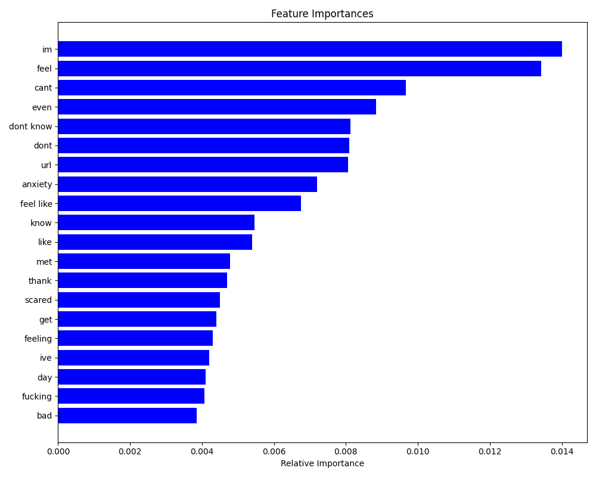

# Stress detection in Reddit posts (Dreaddit)

A small NLP project: classify Reddit posts as **stressed or not stressed** using classic machine-learning models on the public Dreaddit dataset.

> This is a text-classification exercise, not a diagnostic tool. It predicts a stress label for a post; it does not detect depression or any medical condition.

## Data

- **Dreaddit** (Turcan & McKeown, 2019): Reddit posts from 10 subreddits, each labelled stressed (1) or not stressed (0).
- Train: 2,838 posts. Test: 715 posts. Files are in `Data/`.
- Paper: Turcan, E. and McKeown, K. (2019), *Dreaddit: A Reddit Dataset for Stress Analysis in Social Media*, LOUHI 2019. https://aclanthology.org/D19-6213/
- Please check the dataset's own terms before reusing or redistributing it.

## What the script does (`code/stress_detection.py`)

1. **Exploration:** label balance, post length, posts per subreddit, posts over time, and correlation between a few built-in text features (readability, sentiment, LIWC word counts) and the stress label.
2. **Preprocessing:** lower-casing, removing non-letters, tokenising and lemmatising with NLTK, removing stop words.
3. **Features:** TF-IDF on unigrams and bigrams.
4. **Models:** Multinomial Naive Bayes and Random Forest, each tuned with 5-fold cross-validated grid search on the training set.
5. **Evaluation:** classification reports on the held-out test set, a confusion matrix, top Random Forest features, and word clouds for stressed vs. non-stressed posts.

Plots are saved to `figures/`.

## Running it

Use Python 3.10-3.13. Very new Python versions may not have ready-made packages for every dependency.

```bash
pip install -r requirements.txt
python code/stress_detection.py
```

The first run downloads the NLTK resources it needs. Each plot opens in a window and the script continues when you close it. The Random Forest grid search tries 81 settings with 5-fold cross-validation, so it can take several minutes.

## Results

Evaluated on the held-out test set (715 posts, 369 stressed and 346 not stressed, so always guessing "stressed" would be right about 52% of the time). One run, Google Colab.

| Model | Best settings (5-fold CV) | CV accuracy (train) | Test accuracy | Recall, stressed | Recall, not stressed |
|---|---|---|---|---|---|
| Naive Bayes | alpha = 0.1 | 0.738 | 0.69 | 0.91 | 0.46 |
| Random Forest | 300 trees, min_samples_leaf = 2, min_samples_split = 10 | 0.741 | 0.69 | 0.91 | 0.45 |

What this shows:

- Both models beat the 52% baseline, at about 69% test accuracy.
- They catch most stressed posts (recall 0.91) but label more than half of the not-stressed posts as stressed (recall about 0.45), so precision for the stressed class is only 0.64.
- The much heavier Random Forest search did not beat simple Naive Bayes.
- Test accuracy is lower than cross-validation accuracy, so some of the training performance does not carry over.

- The most important Random Forest features are mostly first-person and feeling words ("im", "feel", "cant", "anxiety"). Some are cleaning artefacts ("im", "ive" from stripped apostrophes, and "url"), which is a sign the preprocessing could be improved.





The other plots (label balance, post lengths, subreddits, correlations, word clouds) are in `figures/`.

## Limitations

- One public dataset, small by modern standards; results will not transfer to other platforms or populations.
- Bag-of-words models ignore context and sarcasm.
- Labels come from crowd annotation, so they are noisy.
